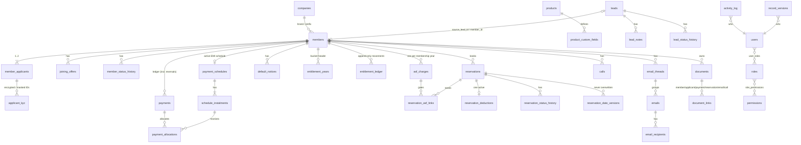

# Data model

63 tables. Conventions: UUID primary keys plus human-readable numbers (`L-2026-000123`, `MSMC8-9030`,
`R-2026-000001`, `RC8-2026-000001`); money `numeric(14,2)` with an ISO-4217 `currency`; nights `numeric(5,1)`;
timestamps `timestamptz` (UTC); a `version` column on editable records for optimistic locking; soft delete
(`deleted_at/by/reason`); `created_by/updated_by`. Unique constraints cover membership number, receipt number,
lead number and reservation number. Check constraints cover totals, balances, years, card last-4 and statuses.
Every search column is indexed (trigram GIN when `pg_trgm` is available).

## Groups
| Group | Tables |
|---|---|
| Users and access | `users`, `roles`, `permissions`, `user_roles`, `role_permissions`, `refresh_tokens` |
| Companies and catalogue | `companies`, `products`, `product_custom_fields`, `joining_offer_types` |
| Leads | `leads`, `lead_notes`, `lead_status_history` |
| Members | `members` (incl. `custom_fields` JSONB), `member_applicants`, `applicant_kyc`, `joining_offers`, `member_status_history` |
| Finance | `payment_schedules`, `schedule_instalments`, `payments`, `payment_allocations`, `receipts`, `asf_charges`, `reservation_asf_links`, `default_notices` |
| Reservations and entitlement | `reservations`, `reservation_status_history`, `reservation_date_versions`, `entitlement_years`, `entitlement_ledger`, `reservation_deductions` |
| Correspondence | `email_threads`, `emails`, `email_recipients`, `calls`, `documents`, `document_links`, `letter_templates` |
| Audit | `activity_log` (hash-chained, append-only), `record_versions` (append-only) |
| Master data | `resort_categories`, `seasons`, `season_calendar`, `unit_types`, `asf_rates`, `tax_rates`, `deduction_matrix`, `cancellation_tiers`, `payment_types`, `payment_methods`, `currencies`, `document_types`, `destinations`, `properties`, `reasons`, `venues`, `lead_sources`, `holiday_calendar`, `status_definitions`, `system_settings`, `saved_searches`, `number_sequences` |

## Key invariants (enforced in the database)
* `members.total_price = purchase_price + admin_fees`; `balance = total_price − down_payment_amount`.
* `payments.total_amount = base_amount + gst_amount`; `card_last4 ~ '^[0-9]{4}$'`; a NORMAL entry is positive.
* `asf_charges (member_id, membership_year)` is unique.
* `reservation_deductions (reservation_id) WHERE state IN ('HELD','DEDUCTED')` is unique (one active deduction).
* `entitlement_ledger.idempotency_key` is unique; `delta <> 0`.
* `payment_schedules (member_id) WHERE is_active` is unique; `default_notices (member_id) WHERE status='OPEN'` is unique.
* `activity_log`, `record_versions`, `entitlement_ledger`: UPDATE, DELETE and TRUNCATE are rejected by trigger.
